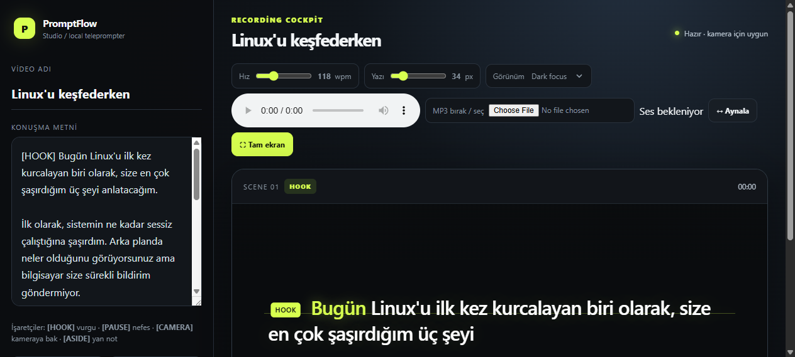

# PromptFlow Studio

Yerel çalışan, sesle senkronize bir teleprompter. Bir ses dosyasını sürükleyip bırakın; PromptFlow konuşmayı yerel Whisper modeliyle analiz eder, metni üretir ve her kelimeyi ses içindeki gerçek zamanına bağlar.



## Neden PromptFlow?

Sabit WPM tabanlı teleprompterlar vurgu, kelime uzatma, nefes ve duraklamalarda konuşmacının gerisinde kalır. PromptFlow ses dosyasını ana zaman kaynağı olarak kullanır:

- Kelime seviyesinde zaman damgası çıkarır.
- Vurgu ve düzensiz konuşma hızlarını takip eder.
- Uzun metni okunabilir parçalara bölerek ekranda aşağı doğru kaydırır.
- Ses ve metni yerel bilgisayarda işler; buluta ses göndermez.
- Metin sesle uyuşmuyorsa, sesin transkriptini otomatik olarak kullanabilir.

## Özellikler

- MP3, WAV, M4A ve OGG sürükle-bırak desteği
- Türkçe dahil otomatik dil algılama
- Whisper `large-v3-turbo` ile kelime zamanlaması
- Ses dosyasını prompter ile birlikte oynatma
- Gerçek zamanlı kelime vurgusu
- Odak çizgili, tam ekran okuma modu
- Ayna görünümü
- Birden fazla MP3'ü tek seferde bırakma: her dosya sırayla işlenen ayrı bir sahne olur
- Yerel kütüphane: hizalanan sahneler `library/` klasörüne kaydedilir, Whisper çalıştırmadan yeniden açılır
- "Cümleyi ayır ⧉": o anki cümleyi her zaman üstte duran, taşınabilir bir pencerede gösterir (Chrome/Edge)
- Sıcak tutulan model: Whisper sunucu açılırken bir kez yüklenir, NVIDIA GPU varsa otomatik kullanılır
- Tamamen lokal çalışma

## Hızlı başlangıç — Windows

Gereksinimler:

- Windows 10/11
- Python 3.12
- FFmpeg ve PATH üzerinde `ffmpeg`
- İnternet bağlantısı: yalnızca ilk Whisper model indirmesi için

1. Depoyu klonlayın veya GitHub’dan indirin.
2. Proje klasöründe sanal ortam oluşturun ve bağımlılığı yükleyin:

   ```powershell
   uv venv .venv312 --python 3.12
   uv pip install --python .venv312\Scripts\python.exe faster-whisper
   ```

3. `start-promptflow.bat` dosyasını çalıştırın.
4. Açılan tarayıcı penceresinde konuşma metnini temizleyin.
5. Bir veya birden fazla ses dosyasını `MP3 bırak / seç` alanına sürükleyin. Başlıktaki durum `Model hazırlanıyor…` yazıyorsa model arka planda yükleniyordur.
6. `Metin sesten oluşturuldu ✓` mesajını bekleyin.
7. `▶` düğmesine basın.

İlk analizde model indirileceği için işlem daha uzun sürebilir. Sonraki analizler yerel modelden yapılır.

## Ekran düzeni

Prompter sayfanın sol üst köşesinden başlar ve tüm yüksekliği kaplar. Başlık, durum, araçlar, sahne listesi, kütüphane, metin düzenleyici ve kısayol ipuçları sağdaki panelde yer alır. 900 px'ten dar ekranlarda panel prompterin altına iner.

## Toplu işleme ve sahneler

Birden fazla ses dosyası seçildiğinde her biri `Sahneler` listesine ayrı bir sahne olarak eklenir ve sırayla (aynı anda tek dosya) analiz edilir. Durumlar: `Sırada`, `İşleniyor`, `Hazır ✓`, `Hata`. İlk sahne hazır olduğu anda okunabilir; diğerleri arka planda işlenmeye devam eder. Bir satıra tıklamak o sahnenin sesini, metnini ve zamanlamasını prompter'a yükler.

## Yerel kütüphane

- Her sahne analiz biter bitmez `library/<ad>/` klasörüne kaydedilir: orijinal ses dosyası (`audio.<uzantı>`) ve `scene.json` (başlık, metin, kelime zamanları, kayıt zamanı).
- `Yerel kaydet` etkin sahneyi, `Tümünü kaydet` hazır olan tüm sahneleri kaydeder. Aynı başlıkla kaydetmek eski kaydın üzerine yazar.
- `Kütüphane` listesindeki bir kayda tıklamak sahneyi yeniden analiz etmeden, senkronize ve oynatılabilir olarak açar. `×` kaydı siler.
- `library/` klasörü Git'e dahil edilmez.

## Cümleyi ayır (her zaman üstte pencere)

`Cümleyi ayır ⧉` düğmesi, o anda okunan cümleyi büyük puntoyla ve aktif kelime vurgulu olarak ayrı bir pencerede gösterir. Pencere diğer uygulamaların üstünde kalır, istenen monitöre sürüklenebilir; yazı boyutu pencere boyutuna göre ölçeklenir. Document Picture-in-Picture API'si gerektirir (Chrome/Edge); desteklemeyen tarayıcılarda düğme pasiftir.

## Mevcut metinle çalışma

Ses dosyasına ait metin zaten elinizdeyse metin alanına yapıştırabilirsiniz. Sesle metin yeterince eşleşirse PromptFlow mevcut metni koruyup zaman damgalarını ona bağlar. Eşleşme düşükse ses transkriptini kullanır.

Metni analizden sonra değiştirirseniz MP3’ü tekrar sürükleyerek senkronu yenileyin.

## Proje yapısı

```text
PromptFlow-Teleprompter/
├── index.html                  # Teleprompter arayüzü ve istemci kodu
├── align_server.py             # Yerel Whisper analiz sunucusu
├── start-promptflow.bat        # Windows başlatıcısı
├── requirements.txt            # Python bağımlılığı
├── library/                    # Kaydedilen sahneler (Git'e dahil değil)
├── LICENSE                     # MIT lisansı
└── docs/screenshots/           # README görselleri
```

## Mimari

```text
Ses dosyası
    │
    ├── FFmpeg → 16 kHz mono PCM
    │
    ├── faster-whisper large-v3-turbo
    │       └── kelime + başlangıç/bitiş zamanları
    │
    ├── metin eşleştirme
    │
    └── tarayıcı teleprompteri
            ├── ses ana saat
            ├── kelime vurgusu
            └── otomatik odak kaydırma
```

`align_server.py` yalnızca `127.0.0.1:8765` üzerinde çalışır. Ses ve transkript uzak bir servise gönderilmez.

## Notlar

- `large-v3-turbo` ilk çalıştırmada Hugging Face üzerinden indirilir ve yerel önbellekte tutulur.
- Model sunucu açılırken bir kez yüklenir ve tüm isteklerde yeniden kullanılır; durum `GET /health` ile görülebilir.
- CUDA destekli bir GPU bulunursa `float16` ile GPU kullanılır; cuBLAS/cuDNN kitaplıkları eksikse sunucu açılışta otomatik olarak CPU'ya (`int8`) geçer.
- Ortam değişkenleri: `PROMPTFLOW_DEVICE=cpu` (CPU'ya zorla), `PROMPTFLOW_BEAM` (varsayılan `1`, daha yüksek değer daha yavaş ama biraz daha doğru), `PROMPTFLOW_MODEL` (varsayılan `large-v3-turbo`).
- Sunucu konsolu her dosyanın işlem süresini yazar.
- Daha iyi sonuç için ses temiz, tek konuşmacılı ve metinle uyumlu olmalıdır.
- Otomatik transkript, özellikle gürültülü veya çok hızlı kayıtlarda manuel kontrol gerektirebilir.
- GitHub’a sanal ortamlar, model önbelleği, kullanıcı sesleri, `library/` ve çalışma çıktıları dahil edilmez.

## Lisans

MIT — ayrıntılar için [LICENSE](LICENSE) dosyasına bakın.
